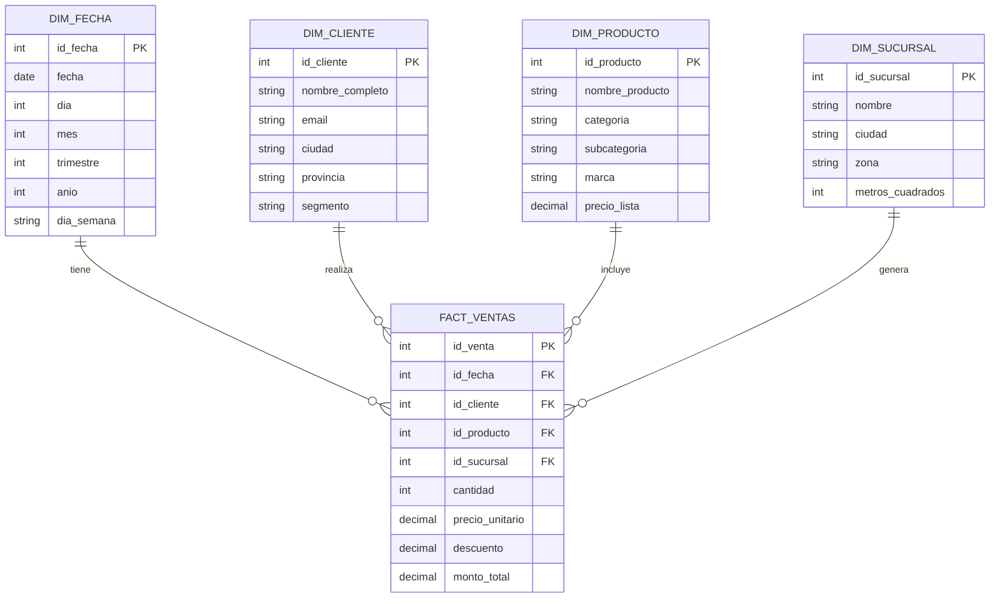
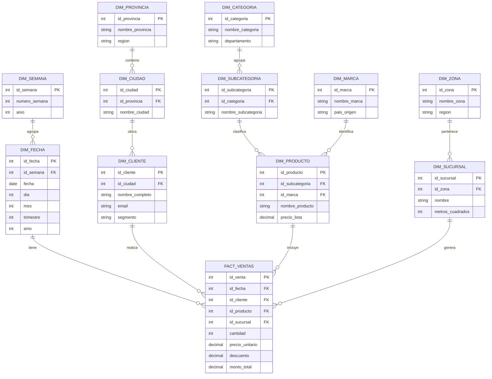

# 📐 Plantilla Mermaid — Modelos Dimensionales

> **Uso:** Copiá el bloque de código en [draw.io](https://app.diagrams.net/) → Extras → Edit Diagram → seleccioná Mermaid  
> O pegalo directamente en [mermaid.live](https://mermaid.live) para previsualizar  
> **Para editar:** reemplazá los nombres de tablas, columnas y relaciones. No toques la sintaxis de corchetes ni los estilos.

---

## Modelo Estrella

**Cuándo usarlo:** siempre que sea posible. Una tabla de hechos central conectada directamente a cada dimensión. Sin conexiones entre dimensiones.



---

## Modelo Copo de Nieve

**Cuándo usarlo:** solo cuando una dimensión es tan grande que degrada el rendimiento. Las dimensiones se normalizan en subdimensiones conectadas entre sí.



---

## Referencia rápida — Sintaxis Mermaid ER

```
%%  Comentario (no se renderiza)

Tipos de dato válidos:
    int     string     decimal     date     bool

Tipos de clave:
    PK      FK         UK  (unique key)

Relaciones:
    ||--||   uno a uno obligatorio
    ||--o|   uno a uno opcional
    ||--o{   uno a muchos (el más común en modelos dimensionales)
    }o--o{   muchos a muchos

Estructura de relación:
    TABLA_A  TIPO_RELACION  TABLA_B : "etiqueta"
    Ejemplo:
    DIM_FECHA  ||--o{  FACT_VENTAS : "tiene"
```

---

## Cómo adaptar estas plantillas a tu proyecto

1. **Renombrá las tablas** — cambiá `FACT_VENTAS`, `DIM_CLIENTE`, etc. por los nombres reales
2. **Editá las columnas** — agregá, quitá o renombrá columnas dentro de cada bloque `{}`
3. **Ajustá las relaciones** — solo modificá los nombres de tabla y la etiqueta entre comillas
4. **En copo de nieve** — agregá o quitá subdimensiones según cuántos niveles tenga tu jerarquía
5. **No toques** — la sintaxis `||--o{`, los `%%`, ni la estructura de bloques

---

*Previsualización online: [mermaid.live](https://mermaid.live)*  
*Draw.io: Extras → Edit Diagram → seleccionar tipo Mermaid*
